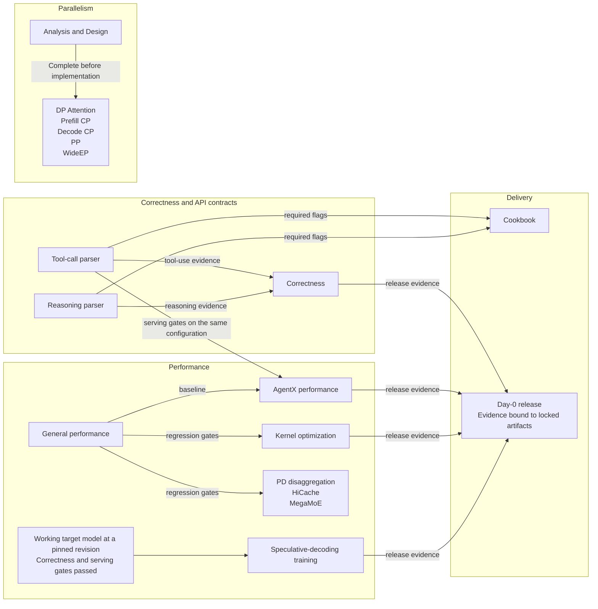

# Feature Catalog

This index organizes the `zai-org/GLM-5-1028-Provider` Day-0 feature projects into priority tiers and records the ordering dependencies between them. Each project owns its summary, stages, and experiment evidence in its own README; this file only defines relative priority and execution order.

## Tiers

### P0 — Release-Gating

P0 projects produce evidence the release cannot ship without. Correctness gates every other project: a result that fails the required correctness gate does not count toward release. General performance provides the baseline and regression gates for every performance claim, so both must be established before downstream performance, kernel, parallelism, or disaggregation results can be accepted.

### P1 — Follow-Up and Selectable

P1 projects are follow-up or per-model optional work. They do not gate the Day-0 release unless the release scope explicitly names them. The Multimodal Optimization and Multi-Platform Support parents are catalogs: the team selects the subprojects the target model requires and records selected and deferred work explicitly in the parent README.

## Dependency Graph

Arrows run left to right from a prerequisite or evidence producer to its consumer.
Grouped nodes list projects with the same prerequisite; they do not imply ordering within the group.

Correctness gates every project's release claims; its universal gate edges are omitted.
Parser paths apply only when the model exposes the corresponding capability; tool calls interrupting reasoning require joint validation.
General-performance evidence is also required by delivery; its direct edge is omitted because the ordering is already represented through AgentX and kernel optimization.
P1 projects are omitted because the bullets below specify selection rules, not fixed project-to-project ordering; selected P1 work still requires correctness validation.

## Ordering and Dependencies

- `p0-correctness/` gates all other projects. No performance or capability claim ships against a configuration that fails its gates.
- `p0-general-performance/` supplies the baseline referenced by `p0-agentx-performance/` and the regression gates applied to `p0-kernel-opt/`, `p0-pd-disagg/`, `p0-hicache/`, and `p0-megamoe/` results.
- `p0-kernel-opt/` changes are accepted only after correctness and general-performance gates pass on the candidate.
- `p0-parallelism/analysis-and-design/` must be Complete before any concrete parallelism subproject (`dp-attention/`, `prefill-cp/`, `decode-cp/`, `pp/`, `wide-ep/`) starts implementation.
- `p0-tool-call-parser/` and `p0-reasoning-parser/` are conditional P0 projects: each gates the release only when the model exposes the corresponding capability, and a not-applicable decision must be recorded explicitly in the feature Summary. When applicable, they supply the tool-use and reasoning behavior evidence consumed by `p0-correctness/`; their template and auto-detection changes must leave every existing model's parser resolution unchanged, and their required flags feed `day0-delivery/cookbook/`. Tool calls interrupting reasoning are validated jointly by the two projects.
- When the model exposes tool use, `p0-agentx-performance/` results are accepted only after `p0-tool-call-parser/` serving gates pass on the same configuration; agentic replay before that point measures an API contract that is not yet validated.
- `p0-spec-decoding-training/` depends on a working target model at a pinned revision; draft training, checkpoint selection, and the SGLang inference handoff all assume the target model passes its own correctness and serving gates first.
- `p1-multimodal-opt/` and `p1-multi-platform/` subprojects are selected per model; an unselected subproject stays a planning placeholder and establishes no support claim.
- [Day-0 Delivery](../day0-delivery/README.md) consumes feature evidence: its release gates bind correctness, general-performance, AgentX, kernel-compatibility, and speculative-decoding results to the locked artifacts.

## Feature Index

| Feature | Tier | Purpose | Status |
|---|---|---|---|
| [p0-correctness/](p0-correctness/README.md) | P0 | Validate model quality, API behavior, feature compatibility, and release-gating regressions. | In progress |
| [p0-tool-call-parser/](p0-tool-call-parser/README.md) | P0 | Implement and validate the tool-call detector and parser auto-detection against the model's native call format. | Not started |
| [p0-reasoning-parser/](p0-reasoning-parser/README.md) | P0 | Implement and validate the reasoning parser, thinking defaults, and supported reasoning levels. | Not started |
| [p0-general-performance/](p0-general-performance/README.md) | P0 | Measure one-batch and online-serving performance and enforce release regression gates. | In progress; E10–E13 delivery sweeps complete, integrated default profiles running |
| [p0-agentx-performance/](p0-agentx-performance/README.md) | P0 | Measure agentic-workload latency, throughput, concurrency scaling, and cache behavior. | Not started |
| [p0-kernel-opt/](p0-kernel-opt/README.md) | P0 | Connect profile evidence to kernel changes, microbenchmarks, and end-to-end impact. | `<STATUS>` |
| [p0-spec-decoding-training/](p0-spec-decoding-training/README.md) | P0 | Train, evaluate, select, and hand off a speculative-decoding draft model. | In progress |
| [p0-pd-disagg/](p0-pd-disagg/README.md) | P0 | Separate prefill and decode resources for predictable latency and independent capacity tuning. | In progress |
| [p0-hicache/](p0-hicache/README.md) | P0 | Reuse prompt prefixes across GPU, host, and storage cache tiers. | In progress; Rust FP8/NVFP4 host/file measured, stopping gate unmet |
| [p0-megamoe/](p0-megamoe/README.md) | P0 | Evaluate and integrate the selected MegaMoE implementation. | `<STATUS>` |
| [p0-parallelism/](p0-parallelism/README.md) | P0 | Choose and implement the parallelism design for the target workload and topology. | In progress |
| [p0-parallelism/analysis-and-design/](p0-parallelism/analysis-and-design/README.md) | P0 | Prerequisite design: topology, rank mapping, composition constraints, and validation plan. | In progress |
| [p0-parallelism/dp-attention/](p0-parallelism/dp-attention/README.md) | P0 | Scale attention request capacity with data-parallel attention. | In progress; E04 paired serving sweep complete |
| [p0-parallelism/prefill-cp/](p0-parallelism/prefill-cp/README.md) | P0 | Partition long-prompt computation across GPUs during prefill. | In progress |
| [p0-parallelism/decode-cp/](p0-parallelism/decode-cp/README.md) | P0 | Reduce per-rank decode KV storage and reads. | Not started |
| [p0-parallelism/pp/](p0-parallelism/pp/README.md) | P0 | Partition model execution across pipeline stages. | Not started |
| [p0-parallelism/wide-ep/](p0-parallelism/wide-ep/README.md) | P0 | Plan and validate expert parallelism across the device and node topology. | `<STATUS>` |
| [p1-breakable-cuda-graph/](p1-breakable-cuda-graph/README.md) | P1 | Retain graph replay benefits around operations that require eager execution. | In progress; default after #85; E03 FP8-KV sweep complete |
| [p1-unified-memory/](p1-unified-memory/README.md) | P1 | Evaluate unified-memory support, capacity, and latency tradeoffs. | In progress |
| [p1-multimodal-opt/](p1-multimodal-opt/README.md) | P1 | Select encoder and serving optimizations for multimodal workloads. | Not started |
| [p1-multimodal-opt/epd-disagg/](p1-multimodal-opt/epd-disagg/README.md) | P1 | Scale multimodal encoding separately from prefill and decode. | `<STATUS>` |
| [p1-multimodal-opt/dp-encoder/](p1-multimodal-opt/dp-encoder/README.md) | P1 | Process encoder batches in parallel within the chosen parallel layout. | `<STATUS>` |
| [p1-multimodal-opt/encoder-cuda-graph/](p1-multimodal-opt/encoder-cuda-graph/README.md) | P1 | Reduce repeated launch overhead in vision-encoder execution. | `<STATUS>` |
| [p1-multi-platform/](p1-multi-platform/README.md) | P1 | Select and validate the hardware platforms required for the release. | In progress |
| [p1-multi-platform/nvidia-hopper/](p1-multi-platform/nvidia-hopper/README.md) | P1 | Establish and validate the selected NVIDIA Hopper configurations. | In progress |
| [p1-multi-platform/nvidia-blackwell/](p1-multi-platform/nvidia-blackwell/README.md) | P1 | Establish and validate the selected NVIDIA Blackwell configurations. | In progress |
| [p1-multi-platform/amd/](p1-multi-platform/amd/README.md) | P1 | Establish and validate the selected AMD configurations. | `<STATUS>` |
| [p1-multi-platform/intel-xpu-xeon/](p1-multi-platform/intel-xpu-xeon/README.md) | P1 | Establish and validate the selected Intel XPU and Xeon configurations. | `<STATUS>` |
| [p1-multi-platform/ascend-npu/](p1-multi-platform/ascend-npu/README.md) | P1 | Establish and validate the selected Ascend NPU configurations. | `<STATUS>` |
| [p1-multi-platform/tpu/](p1-multi-platform/tpu/README.md) | P1 | Establish and validate the selected TPU configurations. | `<STATUS>` |
| [p1-rl/](p1-rl/README.md) | P1 | Define and validate serving integration for reinforcement-learning workflows. | `<STATUS>` |

Status values are `Not started`, `In progress`, `Blocked`, and `Complete`. Replace `<STATUS>` only when the owning feature README records the same state.
